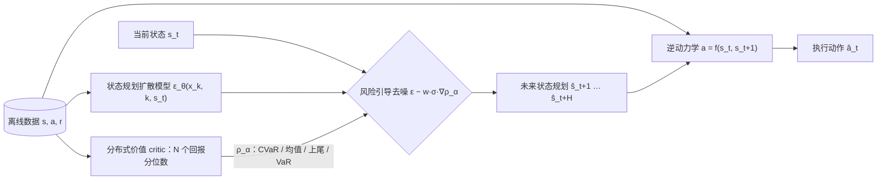

# RS-Diffuser：分布价值指导的风险敏感扩散规划

**RS-Diffuser: Risk-Sensitive Diffusion Planning with Distributional Value Guidance**
ICIC 2026（Oral）· [论文 arXiv:2606.27766](https://arxiv.org/abs/2606.27766)

现有的扩散规划方法是风险中性的：它们优化期望回报，容易忽视罕见但代价巨大的失败。RS-Diffuser 用**分位数回归**学习候选规划的**完整回报分布**，在扩散去噪的每一步用 **CVaR 等尾部风险泛函的梯度**引导采样。规划器和 critic 只训练一次，推理时更换风险泛函，就能让**同一个模型**在风险规避、风险中性、风险偏好之间切换。

## 方法



| 组件 | 做什么 | 论文 | 代码 |
| --- | --- | --- | --- |
| 状态规划器 | 以 s_t 为条件，扩散生成未来 H 步状态 | §4.2，Eq. 3 | `rs_diffuser/agent.py::build_planner` |
| 逆动力学 | 由 (s_t, ŝ_t+1) 解码动作，MSE 训练 | §4.3，Eq. 4 | `rs_diffuser/agent.py::build_invdyn` |
| 分布式 critic | 以带噪规划为输入，输出 N 个回报分位数；用 Monte Carlo 回报做分位数 Huber 回归 | §4.4，Eq. 5–7 | `rs_diffuser/critic.py` |
| 风险泛函 | 下尾 CVaR（规避）、均值（中性）、上尾均值（偏好）、VaR | §4.5，Eq. 8–9 | `rs_diffuser/risk.py` |
| 风险引导采样 | 每个去噪步用 ∇ρ_α 修正噪声预测 | Eq. 10，Algorithm 1 | `rs_diffuser/agent.py::RSDiffuserAgent.act` |

### 推理时切换风险偏好

```python
from rs_diffuser.agent import load_agent

agent = load_agent("runs/halfcheetah-medium-v2/seed0", device="cuda")
agent.set_risk("cvar_lower", alpha=0.1)   # 风险规避：最大化最差 10% 的平均回报
agent.set_risk("mean")                    # 风险中性：最大化期望回报
agent.set_risk("cvar_upper", alpha=0.1)   # 风险偏好：最大化最好 10% 的平均回报
action = agent.act(obs_batch)             # (B, obs_dim) -> (B, act_dim)
```

## 安装

```bash
conda create -n rsd python=3.9 -y && conda activate rsd
# CleanDiffuser 固定到本项目开发时使用的版本（lightning 分支）
pip install "cleandiffuser @ git+https://github.com/CleanDiffuserTeam/CleanDiffuser.git@dea549f6b2aa569f8edf31f053dcecd5f2f6ca36"
pip install -e .
# D4RL 任务另需 MuJoCo 2.1 + mujoco_py 与 D4RL：https://github.com/Farama-Foundation/D4RL
```

> 如果安装 CleanDiffuser 时卡在 `cython==3.0.0a10`，可以先 clone 该提交，把 `pyproject.toml` 中的版本改为 `cython==3.0.0` 再 `pip install -e`。

## 快速开始

**Risky PointMass（纯 numpy 环境，无需 MuJoCo）：**

```bash
python scripts/collect_navigation.py --task risky-pointmass --episodes 2000 --out data/risky-pointmass.hdf5
python scripts/train.py --task risky-pointmass --dataset data/risky-pointmass.hdf5 --out runs/risky-pointmass/seed0
python scripts/evaluate.py --run runs/risky-pointmass/seed0 --risk cvar_lower --alpha 0.1
```

**风险敏感 D4RL：**

```bash
python scripts/make_risky_d4rl.py --task halfcheetah-medium-v2 --out data/halfcheetah-medium-v2-risky.hdf5
for s in 0 1 2 3 4; do
  python scripts/train.py --task halfcheetah-medium-v2 --dataset data/halfcheetah-medium-v2-risky.hdf5 \
      --out runs/halfcheetah-medium-v2/seed$s --seed $s
done
# 100 个 episode × 5 个种子，输出 Mean / Median / CVaR_0.1 / violations 的 mean ± std
python scripts/evaluate.py --run runs/halfcheetah-medium-v2/seed{0,1,2,3,4}
```

默认超参数对应论文 §5.1：2 层 Transformer（隐层 256）、规划步数 H=32、折扣 0.99、DDIM 20 步、Adam 学习率 3e-4、batch 256、训练 1M 步。可在 `RSDiffuserConfig` 中修改。

## 基准设置

**风险敏感 D4RL**（`rs_diffuser/risk_envs.py`）：进入危险状态后，以概率 0.1 获得大额惩罚；最大 episode 长度 500。离线数据与在线评测使用同一套规则。

| 任务 | 危险状态 | 惩罚 |
| --- | --- | --- |
| HalfCheetah | 前向速度 > 4（含 expert 的数据集为 10） | −70 |
| Walker2D | 躯干俯仰角绝对值 > 0.5 | −30 |
| Hopper | 躯干俯仰角绝对值 > 0.1 | −50 |

阈值与惩罚参照 ORAAC（Urpí et al., 2021）/ CODAC（Ma et al., 2021）的设定。

**风险导航**（`rs_diffuser/navigation.py`）：从起点前往目标，最短路径穿过危险区域，区域内每步以概率 0.1 受到 −50 惩罚。violations 记为一个 episode 中处于危险区域的总步数。

- **Risky PointMass**：二维质点，离线数据由“直线穿越 / 左绕 / 右绕”三种带噪脚本控制器混合采集，同时包含冒险与保守轨迹。
- **Risky Ant**：在 MuJoCo Ant 上叠加同样的目标与危险区域。采集离线数据需要一个能完成目标导航的行为策略（如 SAC），本仓库未附带。

## 论文结果

以下为论文表 1、表 2 的结果（100 个 episode × 5 个种子，mean ± std）。

| 任务 | RS-Diffuser CVaR₀.₁ | RS-Diffuser Mean | 最强基线（UDAC）CVaR₀.₁ |
| --- | --- | --- | --- |
| Half-Cheetah Medium | **292 ± 21** | **431 ± 29** | 276 ± 29 |
| Half-Cheetah Expert | **793 ± 125** | **1409 ± 113** | 732 ± 104 |
| Walker-2D Medium | **1493 ± 107** | 1588 ± 74 | 1368 ± 89 |
| Hopper Medium | **1590 ± 31** | **1732 ± 23** | 1502 ± 19 |

| Risky Ant | Mean ↑ | CVaR₀.₁ ↑ | Violations ↓ |
| --- | --- | --- | --- |
| UDAC | −392.5 ± 33.2 | −598.5 ± 50.2 | 291.5 ± 20.8 |
| **RS-Diffuser** | **−365.1 ± 33.2** | **−574.3 ± 53.1** | **269.0 ± 17.5** |

风险敏感 D4RL 的 3 个环境 × 3 种数据集共 9 个设置中，RS-Diffuser 的 CVaR₀.₁ 均为最优。

## 实现细节

- **critic 的条件输入**：当前状态 s_t 固定在规划序列第 0 帧（扩散时通过 `fix_mask` 保持不变），critic 以整段带噪序列为输入，因此同时以 x_k、s_t、k 为条件。
- **分位点**取 τ_i = (i − 0.5)/N，严格落在 (0, 1) 内。计算风险泛函前先对分位数排序，避免分位数交叉影响尾部截取。
- **回报归一化**：critic 的回归目标是 Monte Carlo 折扣回报除以数据集中起点回报的最大绝对值，保存在 `meta.json` 中。
- **候选重排**：每个状态并行采样 32 条候选规划，按 critic 给出的风险值选最优；设 `--num_candidates 1` 即为纯引导采样。
- 逆动力学按 §4.3 实现为确定性 MLP（MSE 回归）。

## 目录结构

```
rs_diffuser/
├── risk.py          # 风险泛函（CVaR / 均值 / 上尾 / VaR）
├── critic.py        # 分位数 Huber 损失与分布式 critic
├── agent.py         # 模型组装、风险引导规划、保存 / 加载
├── data.py          # 规划片段与逆动力学样本、hdf5 读写
├── risk_envs.py     # 风险敏感 D4RL：数据重打标签与评测 wrapper
├── navigation.py    # Risky PointMass / Risky Ant
├── evaluation.py    # Mean / Median / CVaR_0.1 / violations
└── tasks.py         # 任务注册
scripts/             # make_risky_d4rl / collect_navigation / train / evaluate
tests/               # CPU 冒烟测试
```

## 测试

```bash
pip install pytest && pytest -q tests
```

8 项测试覆盖：风险泛函在已知分位数上的取值；分位数回归能还原双峰分布、且上下尾 CVaR 给出相反的风险评价；离线数据与在线评测的风险规则一致；Lightning 训练中规划器与 critic 都被更新；切换风险泛函会改变引导梯度；以及完整的引导采样与动作解码。

## 引用

```bibtex
@inproceedings{gong2026rsdiffuser,
  title     = {RS-Diffuser: Risk-Sensitive Diffusion Planning with Distributional Value Guidance},
  author    = {Gong, Shiqiang},
  booktitle = {International Conference on Intelligent Computing (ICIC)},
  year      = {2026}
}
```

## 致谢

扩散模型、Transformer 骨干与采样器来自 [CleanDiffuser](https://github.com/CleanDiffuserTeam/CleanDiffuser)（Apache-2.0）。
